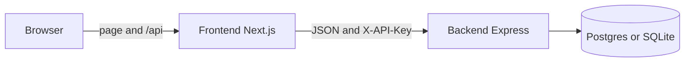

# Willow Clinic

Willow Clinic is a booking API and a booking page: patients see open slots, book one, and get a confirmation.

Backend is Express. Frontend is Next.js. Two URLs.

Contract: [`spec/openapi.json`](spec/openapi.json). Spec routes need `X-API-Key`. Set `API_KEY` in `backend/.env` (not in git).

The page talks to Next.js `/api/*` routes. Those add the key and call Express. Graders and `/docs` call the API host with the key.



UI lives in `frontend/`. API lives in `backend/`. Shared Zod types live in `packages/shared/`.

## Run

Node 22+.

```bash
npm install
cp backend/.env.example backend/.env   # set API_KEY
cp frontend/.env.example frontend/.env.local
npm test
```

Terminal 1:

```bash
npm run dev
```

API: http://localhost:3001  
Docs: http://localhost:3001/docs (Authorize with `X-API-Key` from `backend/.env`)

Terminal 2:

```bash
npm run dev:frontend
```

Page: http://localhost:3000

`npm run dev` seeds the sample timetable if the store is empty. To reset later:

```bash
npm run seed
```

That clears bookings, loads demo slots (Dr Ade, Dr Nkechi, Dr Tunde), and books 12 slots for `ada@example.com` so Load more works (page size 10). Uses SQLite in `backend/data` unless `DATABASE_URL` is set.

### Postgres locally

Without `DATABASE_URL`, the API uses SQLite (`backend/data/clinic.db`, gitignored). Tests do not use that file.

```bash
npm run db
```

Copy `DATABASE_URL` from `backend/.env.example` into `backend/.env`, then start `npm run dev` again. Stop Postgres with `npm run db:down`.

## Tests

```bash
npm test                 # unit + SQLite HTTP, no Docker
npm run test:postgres    # same HTTP contract on Testcontainers Postgres (needs Docker)
```

CI runs both. `test:postgres` does not use `npm run db` or `backend/data`.

## API

Spec routes need `X-API-Key`. `/`, `/health`, `/docs`, and `/openapi.json` do not.

| Method | Path | What |
|---|---|---|
| `GET` | `/slots` | List slots, earliest first. Optional `?provider=` |
| `POST` | `/bookings` | Book a slot |
| `GET` | `/bookings/{id}` | Look up a booking |
| `DELETE` | `/bookings/{id}` | Cancel and free the slot |
| `GET` | `/bookings?email=` | That person's bookings (cursor page) |
| `POST` | `/reset` | Replace the timetable |

Errors: `{ "error": "..." }`.

## Deploy

| Piece | Host | Env |
|---|---|---|
| API | Render (`render.yaml`) | `API_KEY`, `DATABASE_URL` (Postgres), `FRONTEND_ORIGIN` = page URL |
| Page | Vercel, import `frontend` only | Root Directory `frontend`. Include source files outside the root. Install: `cd .. && npm install`. `API_BASE_URL` = Render URL (no trailing slash). `API_KEY` = same as Render (not `NEXT_PUBLIC_`) |

Do not commit `.env` files. Do not use SQLite on Render.

## Config

Backend (`backend/.env`):

| Env | Default |
|---|---|
| `PORT` | `3001` |
| `API_KEY` | required |
| `DB_PATH` | `./data/clinic.db` (when `DATABASE_URL` is unset) |
| `DATABASE_URL` | empty (set for Postgres) |
| `FRONTEND_ORIGIN` | `*` |
| `LOG_LEVEL` | `info` (`silent` during tests) |

Frontend (`frontend/.env.local`):

| Env | Default |
|---|---|
| `API_BASE_URL` | Express URL |
| `API_KEY` | same as backend `API_KEY` |

The browser never sees the key.
