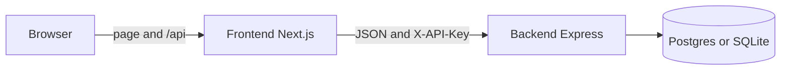
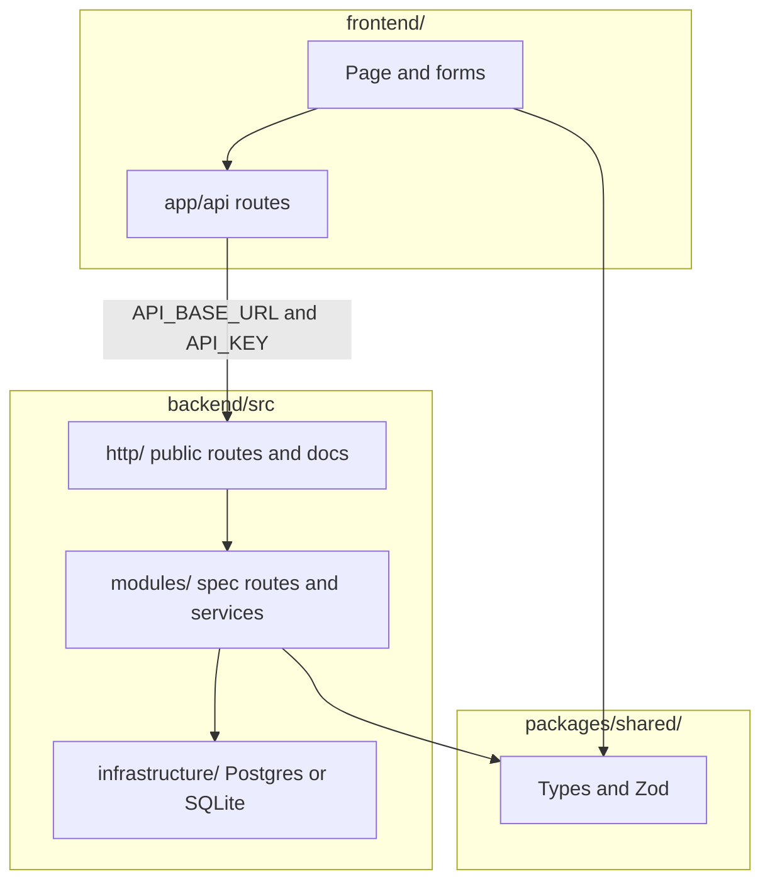

# Willow Clinic

Willow Clinic is a booking API and a booking page: patients see open slots, book one, and get a confirmation.

Backend is Express. Frontend is Next.js. Two URLs.

The page talks to Next.js `/api/*` routes. Those add the key and call Express. `/docs` and other API clients call Express with `X-API-Key`.





## Run

Node 22+.

```bash
npm install
cp backend/.env.example backend/.env
cp frontend/.env.example frontend/.env.local
npm test
```

Set `API_KEY` in `backend/.env`. Use the same value in `frontend/.env.local`.

```bash
npm run dev              # API  http://localhost:3001
npm run dev:frontend     # page http://localhost:3000
```

Docs: http://localhost:3001/docs

Empty store: `npm run dev` loads demo slots. To reset:

```bash
npm run seed
```

Demo doctors: Dr Ade, Dr Nkechi, Dr Tunde. Twelve bookings for `ada@example.com` so Load more works.

Postgres:

```bash
npm run db
```

Copy `DATABASE_URL` from `backend/.env.example` into `backend/.env`, then run `npm run dev` again. Stop with `npm run db:down`. Without it, the API uses SQLite at `backend/data/clinic.db`.

## Tests

```bash
npm test
npm run test:postgres    # needs Docker
```

## API

[`spec/openapi.json`](spec/openapi.json). Spec routes need `X-API-Key`. `/`, `/health`, `/docs`, and `/openapi.json` do not.

| Method | Path | What |
|---|---|---|
| `GET` | `/slots` | List slots, earliest first. Optional `?provider=` |
| `POST` | `/bookings` | Book a slot |
| `GET` | `/bookings/{id}` | Look up a booking |
| `DELETE` | `/bookings/{id}` | Cancel and free the slot |
| `GET` | `/bookings?email=` | That person's bookings (cursor page) |
| `POST` | `/reset` | Replace the timetable |

Errors: `{ "error": "..." }`.

## Deploy

| Piece | Host | Env |
|---|---|---|
| API | Render (`render.yaml`) | `API_KEY`, `DATABASE_URL`, `FRONTEND_ORIGIN` |
| Page | Vercel (`frontend/` only) | `API_BASE_URL`, `API_KEY`. Root Directory `frontend`. Include files outside the root. Install: `cd .. && npm install` |

Postgres on Render. Do not commit `.env` files.

## Config

| Env | Where | Default |
|---|---|---|
| `PORT` | backend | `3001` |
| `API_KEY` | backend and frontend | required |
| `DB_PATH` | backend | `./data/clinic.db` |
| `DATABASE_URL` | backend | empty (Postgres when set) |
| `FRONTEND_ORIGIN` | backend | `*` |
| `LOG_LEVEL` | backend | `info` |
| `API_BASE_URL` | frontend | Express URL |
