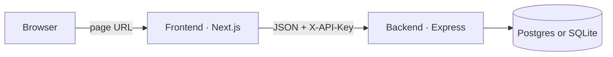
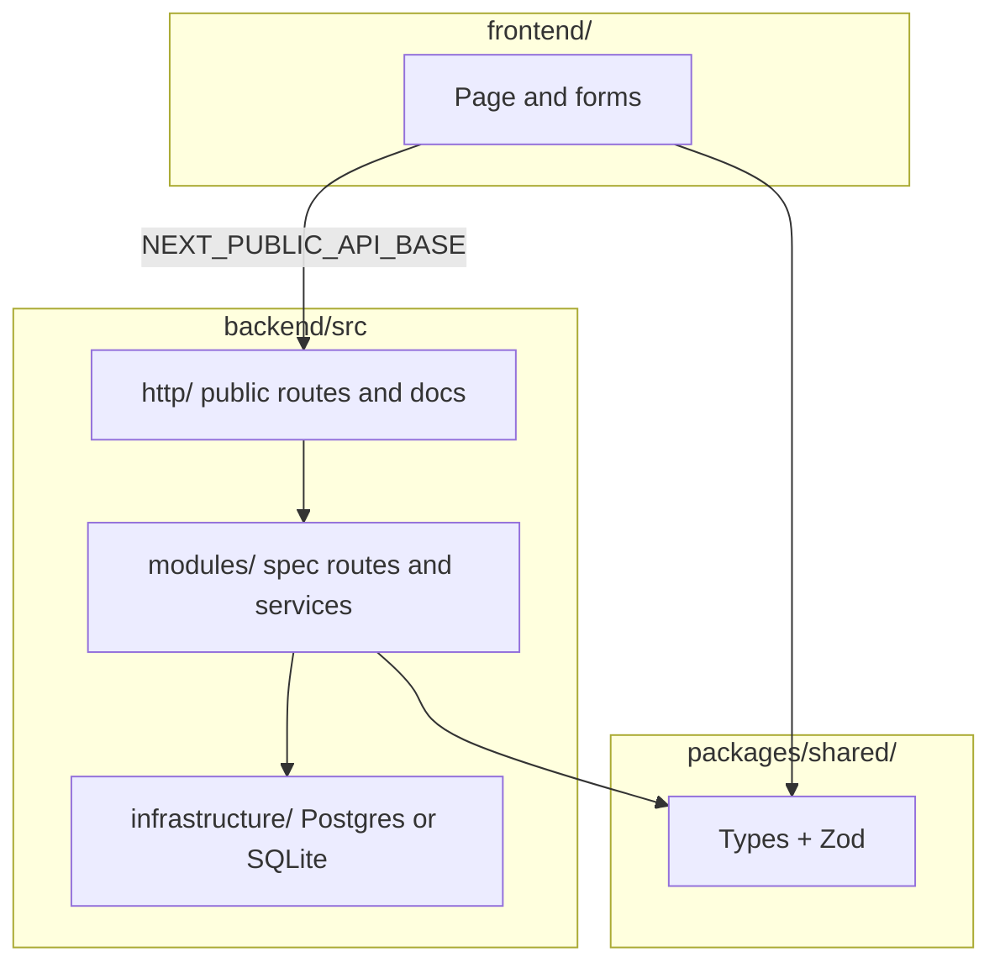

# Willow Clinic

A clinic booking API and a booking page, on two URLs.

- **Backend** — Express API
- **Frontend** — Next.js UI

Contract: [`spec/openapi.json`](spec/openapi.json). Spec routes use `X-API-Key` (see `.env.example`).

---

## Architecture

The browser loads the page from one host and calls the API on another. CORS on the API allows the page.





The frontend never implements `/slots` or `/bookings`. The backend never serves the Next.js app.

Look and the agent workflow (spec → rules → tests → `/review`) are in [DESIGN.md](DESIGN.md).

---

## Run locally

Needs Node 22+. Two terminals:

```bash
npm install
npm test
```

```bash
npm run dev
```

API: [http://localhost:3001](http://localhost:3001)

Docs (Try it out): [http://localhost:3001/docs](http://localhost:3001/docs) — Authorize with `X-API-Key` from `.env.example`.

```bash
npm run dev:frontend
```

Page: [http://localhost:3000](http://localhost:3000)

The UI reads `NEXT_PUBLIC_API_BASE` from env and loads the key from `/config.json` on the API.

### Postgres locally

`npm run dev` uses SQLite until `DATABASE_URL` is set. That writes `backend/data/clinic.db` (gitignored). It is only the local SQLite file. Tests do not use it.

To run the API against Postgres:

```bash
npm run db
```

Copy the `DATABASE_URL` line from `.env.example` into a gitignored `.env`, then `npm run dev` again. Stop it with `npm run db:down`. Compose only runs Postgres; Node still runs on the host.

---

## Tests

```bash
npm test
```

Unit tests for email, booking fields, and cursor pagination, then the HTTP contract against SQLite in memory. Fast, no Docker. Does not read `backend/data`.

```bash
npm run test:postgres
```

The same contract against a throwaway Postgres started by [Testcontainers](https://node.testcontainers.org/modules/postgresql/). Needs Docker. It does **not** use `npm run db` and does **not** use `backend/data`. CI runs both.

| Command | What it is for |
|---|---|
| `npm run db` | Long-lived Postgres so `npm run dev` can use `DATABASE_URL` |
| `npm run test:postgres` | Prove the API against real Postgres, then throw the container away |
| `npm test` | Unit tests + SQLite HTTP contract, no Docker |

---

## Deploy

Two URLs, same as local.

| Piece | Where | What to set |
|---|---|---|
| API | [Render](https://render.com) (`render.yaml`) | `API_KEY`, `DATABASE_URL` from a Render Postgres instance, `FRONTEND_ORIGIN` to the page URL |
| Page | [Vercel](https://vercel.com) | `NEXT_PUBLIC_API_BASE` to the Render API URL, then build |

Do not commit `.env` files. SQLite `DB_PATH` on Render does not survive deploys; use Postgres there.

---

## API

All spec routes need `X-API-Key`. `/`, `/health`, `/docs`, and `/openapi.json` do not.

| Method | Path | What it does |
|---|---|---|
| `GET` | `/slots` | List slots, earliest first. Optional `?provider=` |
| `POST` | `/bookings` | Book a slot |
| `GET` | `/bookings/{id}` | Look up a booking |
| `DELETE` | `/bookings/{id}` | Cancel and free the slot |
| `GET` | `/bookings?email=` | That person's bookings (cursor page) |
| `POST` | `/reset` | Replace the timetable |

Errors: `{ "error": "..." }`. Do not wrap bodies in `{ success, data }` — that is not this spec.

Request logs (method, URL, status, `X-Request-Id`) go to stdout via Pino. `/health` and `/docs` are not logged.

---

## Config

**Backend**

| Env | Default |
|---|---|
| `PORT` | `3001` |
| `API_KEY` | from `.env.example` |
| `DB_PATH` | `./data/clinic.db` (used when `DATABASE_URL` is unset) |
| `DATABASE_URL` | empty — set this for Postgres |
| `FRONTEND_ORIGIN` | `*` |
| `LOG_LEVEL` | `info` (`silent` during `npm test`) |

**Frontend**

| Env | Default |
|---|---|
| `NEXT_PUBLIC_API_BASE` | from env (`frontend/.env.development` locally) |
