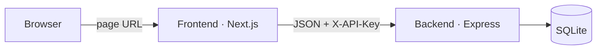
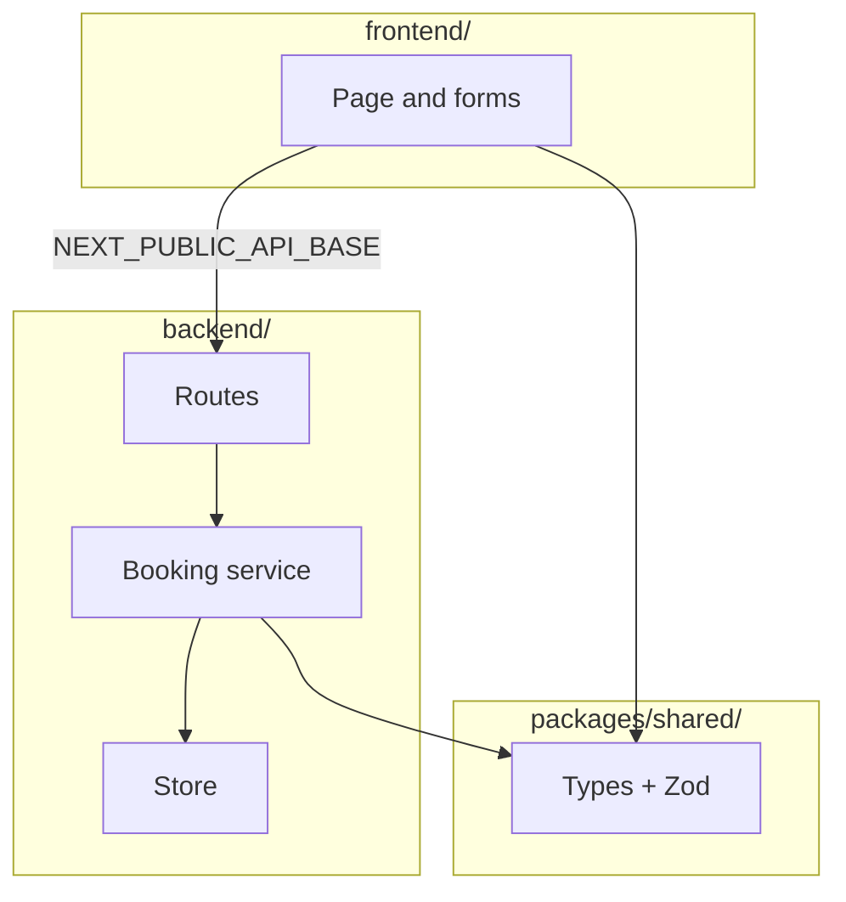

# Willow Clinic

A clinic booking API and a booking page, on two URLs.

- **Backend** — Express API
- **Frontend** — Next.js UI

Contract: [`spec/openapi.json`](spec/openapi.json). Spec routes use `X-API-Key` (see `.env.example`).

---

## Architecture

Industry-standard: the browser loads the page from one host and calls the API on another. CORS on the API allows the page.





The frontend never implements `/slots` or `/bookings`. The backend never serves the Next.js app.

Look and the agent workflow (spec → rules → tests → `/review`) are in [DESIGN.md](DESIGN.md).

---

## Run locally

Needs Node 22+. Two terminals:

```bash
npm install
npm test
```

```bash
npm run dev
```

API: [http://localhost:3001](http://localhost:3001) (set `PORT=3001` if you use the `.env.example`)

```bash
npm run dev:frontend
```

Page: [http://localhost:3000](http://localhost:3000)

The UI reads `NEXT_PUBLIC_API_BASE` (default `http://127.0.0.1:3001`) and loads the key from `/config.json` on the API.

---

## API

All spec routes need `X-API-Key`. `/` and `/health` do not.

| Method | Path | What it does |
|---|---|---|
| `GET` | `/slots` | List slots, earliest first. Optional `?provider=` |
| `POST` | `/bookings` | Book a slot |
| `GET` | `/bookings/{id}` | Look up a booking |
| `DELETE` | `/bookings/{id}` | Cancel and free the slot |
| `GET` | `/bookings?email=` | That person's bookings (cursor page) |
| `POST` | `/reset` | Replace the timetable |

Errors: `{ "error": "..." }`

---

## Tests

```bash
npm test
```

HTTP checks against the **backend** only.

---

## Config

**Backend**

| Env | Default |
|---|---|
| `PORT` | `3000` (use `3001` locally so the UI can use `3000`) |
| `API_KEY` | from `.env.example` |
| `DB_PATH` | `./data/clinic.db` |
| `FRONTEND_ORIGIN` | `*` |

**Frontend**

| Env | Default |
|---|---|
| `NEXT_PUBLIC_API_BASE` | from env (`frontend/.env.development` locally) |

For a hosted split: set `NEXT_PUBLIC_API_BASE` to the API URL before building the frontend. Do not commit `.env` files.
